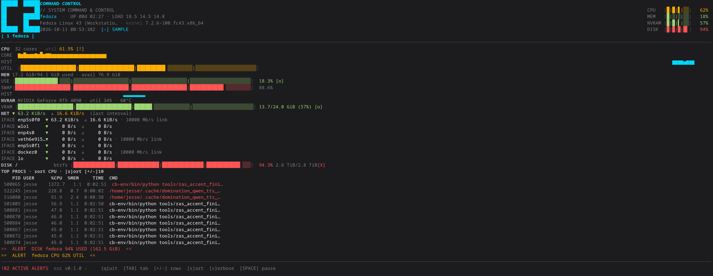

# ccc — Command & Control Center

A low-overhead terminal dashboard for your fleet of machines: CPU, memory, GPU VRAM,
disks, network, and top processes as readable ASCII gauges — local box, remote hosts over
plain SSH, and Kubernetes node fleets via `kubectl`. One static binary on your side; nothing
to install on theirs.



## Why

`htop` watches one machine. Dashboards aimed at fleets want agents, daemons, registries,
and a YAML file before you see a single number. `ccc` is the middle ground: a single Rust
binary with std threads (no async runtime), an embedded POSIX collector script that runs
under bash, dash, BusyBox ash, or any `sh`, and strict output framing so partial garbage
from a flaky link never renders as data. The whole binary is ~2 MB and idles in the low
single-digit megabytes of RSS.

## Install

```sh
cargo build --release          # -> target/release/ccc  (Rust 1.95+)
```

## Run

Set up your fleet once and every launch after that is just `ccc`:

```sh
cat > ~/.config/ccc/ccc.conf <<'CONF'
local fedora                  # your machine
ssh   rack4   -p 2222 admin@10.0.0.4
k8s   default homelab         # kube context, tab reads K8S:homelab
focus fedora
CONF

ccc                           # tabs along the top: fedora · rack4 · K8S:homelab
```

Ad-hoc runs use flags; any `-H`/`--k8s` replaces the config's stations wholesale so a
one-off invocation can't silently merge into your daily fleet:

```sh
ccc --once                    # render one frame to stdout and exit (scriptable)
ccc --config ~/ccc/prod.conf  # multiple profiles, launched by name
ccc --interval 1              # sampling period in seconds (minimum 0.25)
ccc -H 'lab=-p 2222 10.0.0.7' # add a remote station; label first, then ssh args + host
ccc --k8s staging-ctx         # ad-hoc fleet — opens focused on it, no TAB needed
ccc --focus K8S               # start on the tab matching a name/prefix/number
ccc --warn 70 --crit 90       # gauge thresholds (percent)
ccc --top 20                  # process rows per station
```

Remote stations need only a working `ssh`: `ccc` pipes its embedded collector over stdin
(`ssh <host> sh -s`) — no agent, no package, no writes to the remote filesystem. If plain
`ssh <host> uname` works, `ccc -H` works.

Full walkthrough — SSH fleet setup, metrics-server/RBAC for the Kubernetes tab, tuning
knobs, troubleshooting — is in the [setup guide](docs/SETUP.md).

### Keys

| Key | Action |
| --- | --- |
| `TAB` / `→` / `1`–`9` | focus station tab |
| `←` | previous tab |
| `s` | sort processes by CPU / MEM / PID |
| `+` / `-` | more / fewer process rows |
| `v` | verbose (full command lines) |
| `SPACE` | pause updates |
| `q`, `Esc` | quit |

## What's on screen

- **Right rail** — fleet-wide CPU / MEM / NVRAM / DISK bars, color-banded against
  `--warn` / `--crit`.
- **CPU** — aggregate util, per-core sparkline strip, rolling history.
- **MEM** — used/available, swap, rolling history.
- **NVRAM** — NVIDIA utilization, temperature, and VRAM allocation (auto-probed; degrades
  silently where there is no GPU).
- **NET** — true interval deltas (bytes/sec) per interface, with link speed where known.
- **DISK** — real mounts with fstype, usage bar, free/total.
- **TOP PROCS** — union of the top processes by CPU *and* by memory, so a big idle
  allocation can't hide behind busy small ones.
- **Alerts** — red banner lines for anything past `--crit`, counted in the footer. A dead
  SSH link keeps the last good frame on screen stamped `⚠ STALE` instead of blanking.

The Kubernetes tab lists every node with inline CPU/MEM heat bars from `kubectl top`,
ranks your workloads by live usage (TOP PODS, per container), and inventories storage
claims with phase and provisioned size (PVC). Non-`Ready` nodes render red, and when
metrics-server is missing the panel says exactly why instead of showing blanks.

## How it works

One sampler thread per station feeds the renderer over a channel; a tiny reader thread
forwards keypresses. Everything is std: threads + `mpsc`, no tokio, no daemon. Every
external command (`ssh`, `nvidia-smi`, `kubectl`) runs under a hard deadline with drained
pipes, so hung tools can wedge neither the UI nor the process exit.

Data crosses the wire as the line-oriented **CCC/1** protocol: `ccc|1` opens a frame,
keyed rows carry positional fields, `end` closes it. The parser rejects duplicate frames,
out-of-order keys, truncated rows, non-finite numbers, and counter wrap — corruption from
a lossy link surfaces as a station error, never as a plausible-looking number.

## Development

```sh
cargo test                     # unit + CLI integration tests
./target/release/ccc --once    # headless single frame (CI-friendly, scriptable)
```

## License

MIT — see [LICENSE](LICENSE).
